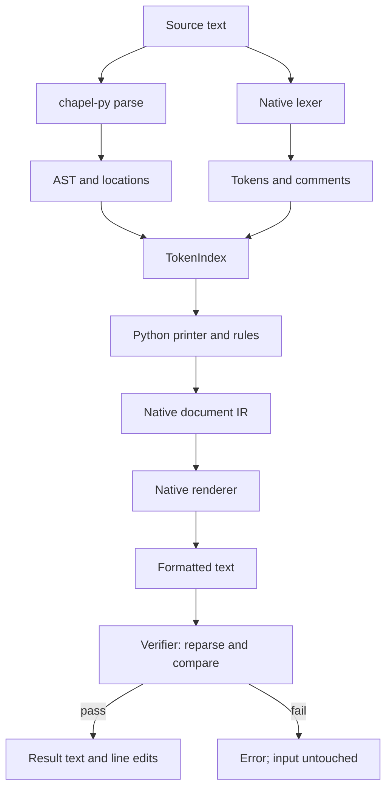

# Developer guide

## Architecture

`chplfmt` uses chapel-py for syntax, its own lexer for source details, and a
document renderer for layout. The public entry point is
[`format_text`](src/chplfmt/api.py); the CLI and LSP call into the same formatting
pipeline.



The AST determines structure; tokens retain spelling, punctuation, comments,
and positions that the AST omits. The printer builds documents without mutating
the AST. Verification must pass before a caller can write the result.

## Component map

### Python

| Area | Responsibility |
|---|---|
| [`src/chplfmt/api.py`](src/chplfmt/api.py) | Orchestrates parse, index, print, render, verify, and line edits. Range formatting selects statements and splices the result into the original text. |
| [`src/chplfmt/_chapel.py`](src/chplfmt/_chapel.py) | Finds chapel-py, checks the Chapel version, and provides the parse shim. |
| [`src/chplfmt/source.py`](src/chplfmt/source.py), [`src/chplfmt/lexer.py`](src/chplfmt/lexer.py), [`src/chplfmt/tokens.py`](src/chplfmt/tokens.py) | Source coordinates, native lexer interface, and AST-to-token index construction. |
| [`src/chplfmt/trivia.py`](src/chplfmt/trivia.py), [`src/chplfmt/comments.py`](src/chplfmt/comments.py), [`src/chplfmt/offregions.py`](src/chplfmt/offregions.py) | Comment placement, whitespace, and verbatim regions. |
| [`src/chplfmt/printer/`](src/chplfmt/printer/) | Construct-specific printers registered by AST type; builds layout documents. |
| [`src/chplfmt/rules/`](src/chplfmt/rules/), [`src/chplfmt/config.py`](src/chplfmt/config.py) | Optional rewrites and their configuration. Rules also define verifier normalizations. |
| [`src/chplfmt/doc/`](src/chplfmt/doc/) | Python interface to native document builders and rendering. |
| [`src/chplfmt/verify.py`](src/chplfmt/verify.py) | Re-parses output and checks AST, tokens, comments, and verbatim regions against the input, allowing only configured rewrites. |
| [`src/chplfmt/cli.py`](src/chplfmt/cli.py), [`src/chplfmt/lsp.py`](src/chplfmt/lsp.py) | File/stdin workflows and editor formatting requests. |

### Rust

[`native/core/`](native/core/) is Python-independent. Maturin and PyO3 build
[`native/py/`](native/py/) as `chplfmt._native`.

| Area | Responsibility |
|---|---|
| [`native/core/src/lexer/scan.rs`](native/core/src/lexer/scan.rs), [`native/core/src/lexer/token.rs`](native/core/src/lexer/token.rs) | Lexes source; defines tokens, kinds, and positions. |
| [`native/core/src/index.rs`](native/core/src/index.rs) | Joins AST facts with tokens; computes spans, ownership, and brackets. |
| [`native/core/src/doc/mod.rs`](native/core/src/doc/mod.rs) | Defines document nodes and layout builders. |
| [`native/core/src/render/mod.rs`](native/core/src/render/mod.rs) | Resolves groups and line breaks; emits formatted text and line records. |
| [`native/core/src/width.rs`](native/core/src/width.rs), [`native/core/src/width/width_table.rs`](native/core/src/width/width_table.rs) | Measures display width using a generated Unicode table. |
| [`native/py/src/lib.rs`](native/py/src/lib.rs) | Exposes native tokens, indexing, and module functions to Python. |
| [`native/py/src/extract.rs`](native/py/src/extract.rs) | Extracts compact AST facts and locations from chapel-py. |
| [`native/py/src/doc.rs`](native/py/src/doc.rs), [`native/py/src/render.rs`](native/py/src/render.rs) | Binds document builders and the renderer to Python. |

[`src/chplfmt/_native.pyi`](src/chplfmt/_native.pyi) describes the extension API
for Python type checking.

## Safety and change points

- Parse errors abort formatting. Verification failures raise an error instead
  of returning output; the CLI leaves the input untouched.
- The verifier checks output in this order: reparse, AST, tokens, comments,
  verbatim regions. A rewrite needs both a printer decision and a matching
  normalization in [`src/chplfmt/rules/`](src/chplfmt/rules/).
- Add construct layout in the appropriate module under
  [`src/chplfmt/printer/`](src/chplfmt/printer/). Change line breaking in
  [`native/core/src/render/`](native/core/src/render/) and document primitives
  in [`native/core/src/doc/`](native/core/src/doc/).
- Keep `// chplfmt: off` and extern regions byte-identical. Range formatting
  should not modify unselected text.
- Document callbacks must not capture the printer or index. Range selections
  retain documents until rendering finishes, so backreferences can retain an
  entire input through a cycle that Python cannot traverse through native docs.
- Native documents canonicalize empty concatenations and share printable ASCII
  text nodes. Flattening reuses unchanged subtrees; zero-width callbacks and
  layout controls must not be discarded as empty text.
- Index rows use packed value buffers and offset pairs. Optional AST locations
  and extra metadata are sparse, and Python token wrappers share the core token
  buffer rather than copying token records.
- Before verification reparses output, the formatter releases its full input
  index. A compact view retains AST children/spans, tokens, and normalized token
  positions; verification still performs every semantic and source check.

## Validation

See [README.md](README.md#development) for setup and full checks. From the
repository root, use up to four workers:

```sh
cargo test --manifest-path native/Cargo.toml --workspace --all-targets
.venv/bin/python -m pytest -n 4 -m "not corpus"
.venv/bin/python -m pytest -n 4 -m corpus
```

Use [`tests/golden/`](tests/golden/) for output examples,
[`tests/options/`](tests/options/) for configuration behavior,
[`tests/unit/`](tests/unit/) for components, and
[`tests/properties/`](tests/properties/) for corpus-wide invariants. The full
corpus and formatting tests need chapel-py; tests marked `native` do not.
For detailed original rationale, see [design.md](design.md). The
[native design note](docs/native-design.md) is a proposal, not a description
of every current implementation detail.
